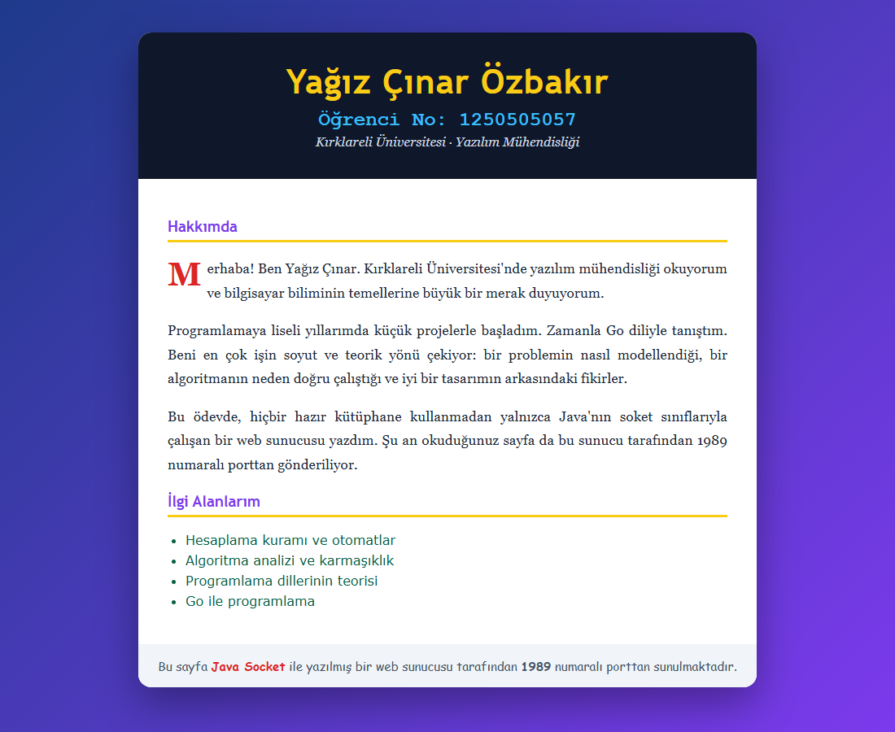

# Java Socket Web Sunucusu

Hiçbir üçüncü parti kütüphane kullanmadan, yalnızca Java'nın standart kütüphanesi (`java.net.ServerSocket` ve `java.net.Socket`) ile yazılmış basit bir HTTP web sunucusu.

Sunucu **1989** numaralı portu dinler. Herhangi bir web tarayıcısıyla bağlanıldığında öğrencinin adını soyadını (H1), öğrenci numarasını (H2) ve renk, yazı tipi gibi HTML/CSS biçimlendirmeleriyle hazırlanmış kısa bir biyografiyi gösterir.


| | |
|---|---|
| **Öğrenci** | Yağız Çınar Özbakır |
| **Öğrenci No** | 1250505057 |
| **Bölüm** | Yazılım Mühendisliği, Kırklareli Üniversitesi |
| **Ders** | Nesneye Yönelik Programlama |
| **Ödev** | Java ve Socket Programlama ile Basit Web Sunucusu |



---

## İçindekiler

- [Özellikler](#özellikler)
- [Gereksinimler](#gereksinimler)
- [Kurulum ve Çalıştırma](#kurulum-ve-çalıştırma)
- [Proje Yapısı](#proje-yapısı)
- [Çalışma Prensibi](#çalışma-prensibi)
- [SOLID Prensiplerinin Uygulanması](#solid-prensiplerinin-uygulanması)
- [Kendi Bilgilerinizi Girme](#kendi-bilgilerinizi-girme)
- [Test](#test)
- [Lisans](#lisans)

---

## Özellikler

- Saf Java ile yazılmış HTTP/1.1 sunucusu (harici bağımlılık yok)
- `ServerSocket` ile 1989 numaralı portun dinlenmesi
- İş parçacığı havuzu (`ExecutorService`) sayesinde aynı anda birden fazla istemciye hizmet
- İsteğin ayrıştırılması (istek satırı + başlıklar) ve standartlara uygun cevap üretilmesi
- `GET` ve `HEAD` metotları; diğer metotlar için `405 Method Not Allowed`
- `200 OK`, `400 Bad Request`, `404 Not Found` ve `405 Method Not Allowed` durum kodları
- 5 saniye boyunca veri göndermeyen bağlantıların zaman aşımıyla kapatılması
- UTF-8 desteği sayesinde Türkçe karakterlerin doğru görüntülenmesi
- SOLID prensiplerine göre katmanlara ayrılmış nesne yönelimli tasarım

## Gereksinimler

- **JDK 17** veya üzeri (`java -version` ve `javac -version` komutlarıyla kontrol edebilirsiniz)

## Kurulum ve Çalıştırma

Depoyu klonlayın:

```bash
git clone https://github.com/YCOzba/java-socket-web-server.git
cd java-socket-web-server
```

**Windows:**

```bat
run.bat
```

**Linux / macOS:**

```bash
sh run.sh
```

**Elle derleme ve çalıştırma:**

```bash
javac -encoding UTF-8 --release 17 -d out -sourcepath src src/webserver/Main.java
java -Dstdout.encoding=UTF-8 -cp out webserver.Main
```

`-sourcepath src` sayesinde derleyici `Main.java`'dan başlayarak kullanılan tüm sınıfları kendisi bulup derler. Komut Windows, Linux ve macOS'ta aynı şekilde çalışır.

Sunucu başladıktan sonra tarayıcınızda şu adresi açın:

```
http://localhost:1989
```

Sunucuyu durdurmak için terminalde `Ctrl + C` tuşlarına basın.

## Proje Yapısı

```
src/webserver/
├── Main.java                         # Giriş noktası; tüm nesneleri oluşturup birbirine bağlar
├── server/
│   ├── WebServer.java                # ServerSocket ile portu dinler, bağlantıları kabul eder
│   └── ClientConnectionHandler.java  # Tek bir istemci bağlantısını işler (Runnable)
├── http/
│   ├── HttpRequest.java              # İstek verisi (record)
│   ├── HttpResponse.java             # Cevap verisi (record)
│   ├── HttpStatus.java               # Durum kodları (enum)
│   ├── HttpRequestParser.java        # Ham metni HttpRequest nesnesine çevirir
│   └── HttpResponseWriter.java       # HttpResponse nesnesini sokete yazar
├── routing/
│   ├── RequestHandler.java           # İstek işleyici arayüzü
│   └── Router.java                   # Yola göre doğru işleyiciyi seçer
├── handler/
│   ├── BiographyPageHandler.java     # Ana sayfa (biyografi) işleyicisi
│   └── NotFoundHandler.java          # 404 sayfası işleyicisi
├── model/
│   ├── StudentProfile.java           # Öğrenci bilgisi (record)
│   ├── ProfileRepository.java        # Bilgi kaynağı arayüzü
│   └── InMemoryProfileRepository.java  # Bilgiyi kod içinde tutan uygulama
└── view/
    ├── PageRenderer.java             # HTML üretici arayüzü
    └── BiographyPageRenderer.java    # Biyografi sayfasının HTML/CSS çıktısı
```

## Çalışma Prensibi

```
Tarayıcı ──TCP bağlantısı──▶ ServerSocket(1989).accept()
                                   │
                                   ▼
                     ClientConnectionHandler (thread havuzu)
                                   │
           HttpRequestParser ──▶ Router ──▶ RequestHandler
                                                  │
                         ProfileRepository + PageRenderer
                                                  │
           HttpResponseWriter ◀── HttpResponse ◀──┘
                   │
                   ▼
   "HTTP/1.1 200 OK" + başlıklar + HTML  ──▶ Tarayıcı
```

1. `WebServer`, `new ServerSocket(1989)` ile işletim sisteminden 1989 numaralı portu ister ve `accept()` metoduyla bağlantı beklemeye başlar.
2. Bir tarayıcı bağlandığında `accept()` yeni bir `Socket` nesnesi döndürür. Bu soket, iş parçacığı havuzundaki bir `ClientConnectionHandler` görevine verilir; böylece sunucu hemen bir sonraki bağlantıyı beklemeye devam eder.
3. `HttpRequestParser`, soketin giriş akışından (`InputStream`) `GET / HTTP/1.1` gibi istek satırını ve başlıkları okuyarak bir `HttpRequest` nesnesi oluşturur.
4. `Router`, isteğin yoluna bakarak uygun `RequestHandler` nesnesini seçer. Kayıtlı olmayan yollar için `NotFoundHandler` çalışır.
5. `BiographyPageHandler`, öğrenci bilgisini `ProfileRepository` üzerinden alır ve `PageRenderer` ile HTML'e dönüştürür.
6. `HttpResponseWriter`, durum satırını, başlıkları (`Content-Type`, `Content-Length` vb.) ve HTML gövdesini soketin çıkış akışına (`OutputStream`) yazar; ardından bağlantı kapatılır.

## SOLID Prensiplerinin Uygulanması

| Prensip | Projedeki Karşılığı |
|---|---|
| **S** – Single Responsibility | Her sınıfın tek bir görevi vardır: `WebServer` yalnızca bağlantı kabul eder, `HttpRequestParser` yalnızca ayrıştırır, `HttpResponseWriter` yalnızca yazar, `BiographyPageRenderer` yalnızca HTML üretir. |
| **O** – Open/Closed | Yeni bir sayfa eklemek için mevcut sınıflar değiştirilmez; `RequestHandler` arayüzünü uygulayan yeni bir sınıf yazılıp `router.register(...)` ile kaydedilir. |
| **L** – Liskov Substitution | `RequestHandler`, `PageRenderer` ve `ProfileRepository` arayüzlerinin tüm uygulamaları birbirinin yerine kullanılabilir; çağıran kod hangi somut sınıfla çalıştığını bilmek zorunda değildir. |
| **I** – Interface Segregation | Arayüzler küçük ve amaca özeldir; her biri yalnızca tek bir metot tanımlar (`handle`, `render`, `getProfile`). |
| **D** – Dependency Inversion | `BiographyPageHandler` somut sınıflara değil arayüzlere bağımlıdır. Bağımlılıklar yapıcı metot (constructor injection) ile `Main` sınıfında verilir. |

## Kendi Bilgilerinizi Girme

Ad soyad, öğrenci numarası, biyografi ve ilgi alanları tek bir dosyada tutulur:

```
src/webserver/model/InMemoryProfileRepository.java
```

Bu dosyadaki metinleri değiştirip uygulamayı yeniden çalıştırmanız yeterlidir.

## Test

Tarayıcı dışında `curl` ile de test edilebilir:

```bash
curl -i http://localhost:1989/          # 200 OK + biyografi sayfası
curl -I http://localhost:1989/          # HEAD isteği: yalnızca başlıklar
curl -i http://localhost:1989/yok       # 404 Not Found
curl -i -X POST http://localhost:1989/  # 405 Method Not Allowed
```

Sunucu her isteği konsola şu biçimde kaydeder:

```
[127.0.0.1:52344] GET / -> 200
```

## Lisans

Bu proje eğitim amacıyla hazırlanmıştır.
